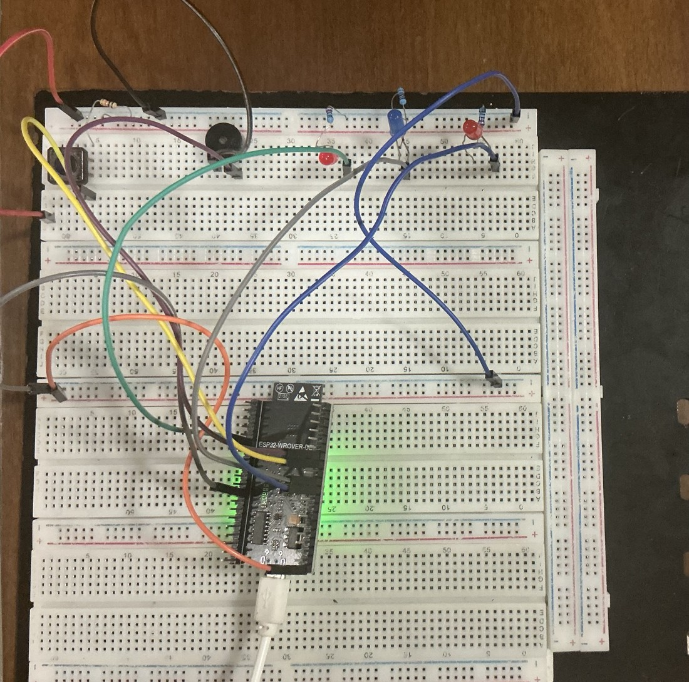
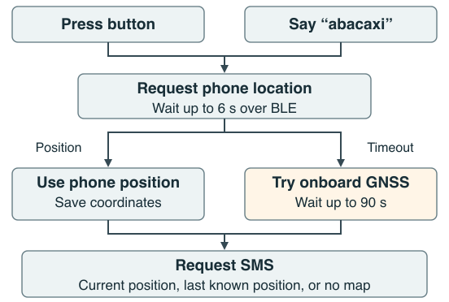
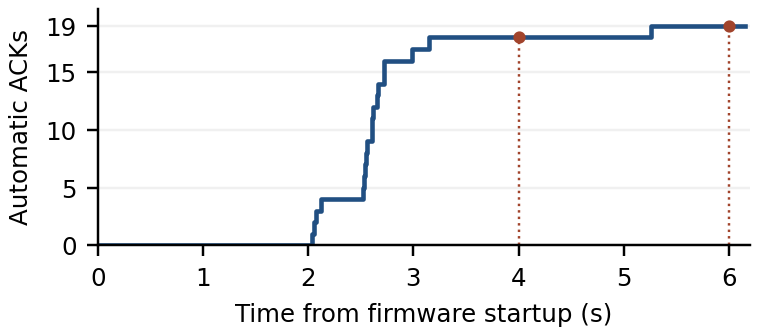
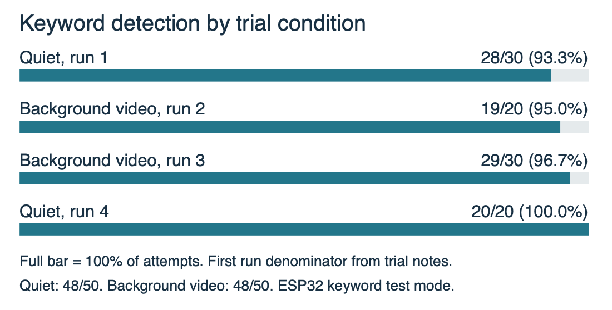
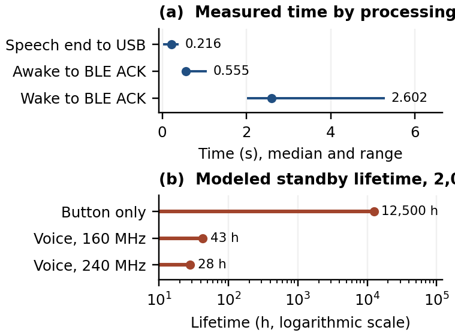
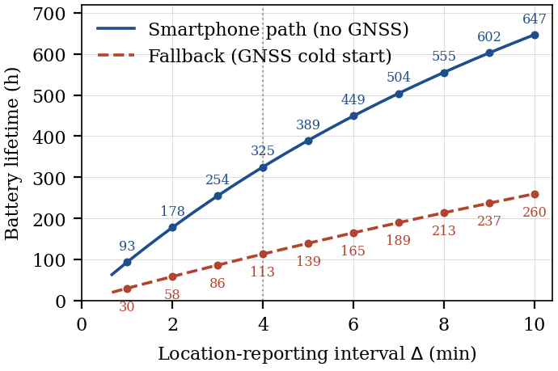

# Botão de emergência com localização alternativa ao celular

Projeto de Sistemas Embarcados (IBM3118) de Letícia Valladão e Vinicius Dias, Ibmec, 2026.2. O botão foi pensado para passar a maior parte do tempo guardado, pronto para iniciar um pedido de ajuda. A ESP32 tenta obter coordenadas de um cliente Bluetooth. Se o cliente some, a placa mantém a emergência ativa e passa a pedir a posição ao receptor GNSS.

[Hardware, software e modelo de voz](docs/sistema.md) · [Artigo e referências](article/) · [Firmware integrado](firmware/panic_button/panic_button.ino) · [Guia da demonstração](docs/demonstracao.md) · [Dados de bancada](results/) · [Simulação de autonomia](simulation/)



*Montagem da AP1. A protoboard contém o botão de acionamento, a ESP32-WROVER e os indicadores usados para acompanhar o alerta.*

## O que acontece após o acionamento



1. No perfil de botão, um toque acorda a ESP32 do sono profundo. No perfil de voz, a placa fica acordada a 160 MHz e aceita o botão ou “abacaxi”. Os dois acionamentos entram na mesma rotina de emergência.
2. A placa anuncia o serviço BLE e pede uma posição. O cliente devolve latitude, longitude e precisão. O prazo configurado na revisão AP2 é **6 s**.
3. Sem coordenadas válidas do cliente, a ESP32 aciona a aquisição GNSS. Ela confere o checksum e o estado da sentença RMC e converte as coordenadas. Se os **90 s** terminarem, o alerta leva a última posição conhecida, identificada como tal, ou informa que a localização está indisponível.
4. Em ambos os caminhos, o firmware solicita um SMS à interface do modem. Na bancada, a ponte USB emula o SIM800L e pode encaminhar o texto ao Telegram. `SMS_OK` corresponde à aceitação pelo modem emulado. O encaminhamento pelo Telegram tem registro próprio.
5. A placa guarda estado, contagem e próxima atualização na memória RTC. Um atraso na aquisição não reinicia a contagem do intervalo. Os ensaios integrados usam **60 s** entre atualizações. Depois de uma falha do cliente, os próximos envios dessa emergência seguem direto ao GNSS. Segurar o botão por **3 s** encerra a emergência.

| Função | Implementação de bancada |
|---|---|
| Botão, controle da emergência e processamento de voz | ESP32-WROVER física. O botão usa GPIO 33. O Mac fornece amostras mono de 16 kHz pela USB. A inferência roda na placa. |
| Cliente de localização | Página Web Bluetooth no ensaio histórico. Na demonstração, o painel nativo do macOS usa Core Bluetooth e Core Location. |
| GNSS e modem celular | O Mac fornece sentenças NMEA e respostas AT. O firmware decide se a posição é válida e constrói a mensagem. |
| Alimentação e gabinete | Placa alimentada por USB. Bateria de 2.000 mAh, módulos físicos e montagem compacta fazem parte do projeto de integração. |

## Resultados medidos

| Ensaio | Resultado | O que o relógio mede |
|---|---|---|
| Placa acordada, navegador AP1 | 16 ACKs em 16 tentativas. Mediana **0,555 s**. | Até a placa receber o ACK da página. |
| Após sono profundo | 21 ACKs em 22 tentativas. Dois exigiram reconexão manual. Nas 19 automáticas, mediana **2,602 s** e faixa **2,039–5,262 s**. | Do início do firmware ao ACK. Exclui o boot da ROM. Na página AP1, a requisição ao Telegram precedia o ACK. O cliente atual inverte essa ordem. |
| Palavra em silêncio | **28/30 e 20/20**. Mediana de **216 ms** nas 48 detecções. | Do fim estimado da fala ao registro USB. |
| Palavra com vídeo ao fundo | **19/20 e 29/30**. | O vídeo interfere na estimativa do fim da fala. A análise usa as contagens de detecção. |




A janela histórica era de 60 s. Dezenove respostas foram automáticas, das quais dezoito chegaram até 4 s. A última incluiu uma nova consulta de localização no navegador. O limite de **6 s** deixa 0,738 s acima do máximo observado e antecipa em 9 s a tentativa de GNSS em relação aos 15 s da AP1. A validação prospectiva no firmware de 6 s continua pendente.

A revisão integrada também exercitou a perda do cliente depois do primeiro envio e o uso da última posição conhecida após o timeout do GNSS. O teste dedicado de 30 minutos sem a palavra e o ensaio de acionamento com um mesmo ponto final estão disponíveis em [experiments/activation](experiments/activation/LEIA-ME.txt). A taxa de falsos alarmes por hora continua em aberto.

## Consumo e autonomia projetados



| Perfil de espera | Corrente modelada | Autonomia ideal |
|---|---:|---:|
| Só botão em sono profundo | 0,160 mA | 12.500 h |
| Botão e voz a 160 MHz | 46,65 mA | 43 h |
| Botão e voz a 240 MHz | 70,65 mA | 28 h |

A escuta a 160 MHz consome cerca de 292 vezes a corrente de espera do perfil de botão no modelo. A duração real depende da placa montada, das perdas e da bateria. Os tempos de voz e Bluetooth mostrados acima terminam em eventos diferentes.



Durante a emergência, espaçar as atualizações de um para quatro minutos eleva a autonomia projetada de **93 para 325 h** com coordenadas do cliente e de **30 para 113 h** com aquisição GNSS a frio. O modelo assume 27 s por aquisição a frio, 3 s por transação de SMS e usa o ACK histórico de 2,602 s como aproximação para a etapa do celular. O script registra os parâmetros e as fontes. [Simulador](simulation/energy_sim.py) · [Gráfico de espera por perfil](simulation/standby_activation.pdf)

## Implementação do grupo

- **Reconexão BLE.** Serviço GATT com notificação de alerta e característica de escrita para o ACK. O painel guarda o identificador da placa e tenta retomar a conexão; o navegador depende também das permissões e do seu estado de execução.
- **Acionamento por voz.** A janela tem um segundo e avança em fatias de 250 ms. O firmware exige duas pontuações consecutivas de pelo menos 0,80. A troca de classificador reduziu a estimativa de inferência de 826 para 11 ms e a RAM do classificador de 166,2 para 14,7 kB. A captura de áudio e a extração de características têm custo adicional.
- **Ponte de bancada.** Áudio, NMEA e respostas do modem trafegam pela USB a 460.800 baud. A posição fixa permite repetir a demonstração. O firmware verifica cancelamento durante a espera da posição.
- **Envio periódico.** O agendamento usa o relógio RTC para manter a cadência. A falha do cliente é registrada uma vez por emergência e impede tentativas BLE repetidas durante o fallback.

## Reproduzir a análise

Com Python 3, NumPy e Matplotlib instalados, execute na raiz do repositório:

```sh
python3 results/analyze.py
python3 results/plot_results.py
(cd simulation && python3 energy_sim.py)
```

As medições BLE estão em [deepsleep_meas.csv](results/deepsleep_meas.csv) e [awake_summary.csv](results/awake_summary.csv). Para voz, [voice_trials.csv](results/voice_trials.csv) reúne os denominadores das quatro rodadas e [voice_detections.csv](results/voice_detections.csv) contém as detecções individuais. O total de 30 tentativas da primeira rodada vem das anotações do ensaio. A ponte também atende à demonstração com botão, e o [script de preparação de áudio](tools/split_keyword.py) gera amostras de um segundo para o treinamento.

O próximo ensaio físico é integrar receptor, modem, microfone e bateria, medir a corrente em cada estado e confirmar entrega de SMS com o cliente BLE indisponível. Também falta avaliar o reconhecimento com o dispositivo no bolso e a recepção GNSS dentro e fora de edifícios.
